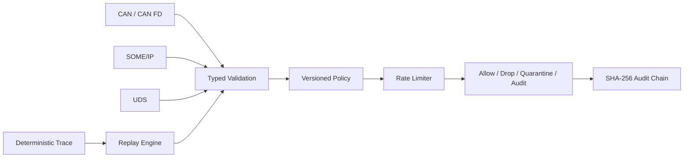

# RustGuard Vehicle Gateway

A memory-safe automotive communication policy gateway and deterministic security-replay laboratory written in Rust. It validates, filters, rate-limits, quarantines and audits CAN, SOME/IP and UDS messages through explicit versioned policy.

> The default profile is host simulation only. It does not control a physical vehicle, flash an ECU, or establish safety/cybersecurity certification.

## Implemented

- dependency-free Rust core with `unsafe_code = "forbid"`
- strongly typed Classical CAN/CAN FD, SOME/IP and UDS messages
- CAN identifier and payload validation
- SOME/IP base-header parser and structural checks
- UDS service classification and default-deny diagnostic policy
- line-oriented, reviewable policy language
- allow, drop, rate-limit, quarantine and audit decisions
- per-rule/interface one-second rate windows
- deterministic trace parser and replay
- replay bounds of **1,000,000 messages**
- payload bounds: Classical CAN **8 bytes**, CAN FD **64 bytes**, UDS **4,095 bytes**, SOME/IP **1,048,576 bytes**
- tamper-evident SHA-256 audit hash chain
- JSON summary CLI and runnable attack/traffic fixture
- **44 dependency-free Rust tests**

## Quick start

Requires Rust 1.75 or later.

```bash
cargo test --all-targets
cargo clippy --all-targets --all-features -- -D warnings
cargo run --release -- --policy policies/host.policy --trace traces/demo.trace
```

Example output reports allowed, audited, dropped, rate-limited and quarantined messages plus audit-chain integrity and head hash.

## Policy format

```text
version 1.0
default drop
can vehicle-speed allow can0 0x100 0x7ff 8 100
someip vehicle-state allow eth0 0x1234 0x0001 1024 50
uds read-data allow diag0 0x22 0x01 technician 20
uds block-programming drop diag0 0x34 0x02 * 1
```

Fields are deliberately explicit and easy to review. The final field is maximum messages per one-second window.

## Trace format

```text
0 can can0 0x100 standard classic 002a
4000 someip eth0 0x1234 0x0001 1 1 0x00 5245414459
6000 uds diag0 0x22 - 0x01 technician f190
```

All timestamps are microseconds. Replay sorts messages by timestamp.

## Architecture



See [architecture](docs/architecture.md), [policy reference](docs/policy-reference.md), and [threat model](docs/threat-model.md).

## Safety behavior

- Unknown traffic is dropped by the supplied policy.
- Programming and write-oriented UDS services are explicitly denied.
- Malformed protocol data is quarantined before policy evaluation.
- No SocketCAN transmit, raw Ethernet transmit, ECU flashing, or physical actuator adapter is included.
- An allow decision means only that the configured gateway policy matched. It is not a safety authorization.

## Honest roadmap

Linux SocketCAN, CAN FD socket integration, raw Ethernet, full SOME/IP/SD, ISO-TP, full UDS state machines, authenticated identities, hardware security modules, persistent counters, PCAP import/export, fuzzing, `no_std` extraction, AUTOSAR integration, HIL and target timing evidence are not yet implemented.

## Security and licensing

The core has no external crate dependencies and forbids unsafe Rust. CI runs tests, Clippy, CodeQL, dependency review and a deterministic demo. Never commit production policies, captures, credentials, keys, VINs or customer network definitions. See [SECURITY.md](SECURITY.md).

This version is proprietary and source-available. Production, commercial, customer, vehicle, embedded-system or field use requires a separate written commercial license. See [LICENSE](LICENSE) or contact `nagaraj.rbhagwat@expleogroup.com` or an authorized Expleo Group representative. The initial historical MIT commit retains its prior grant.
